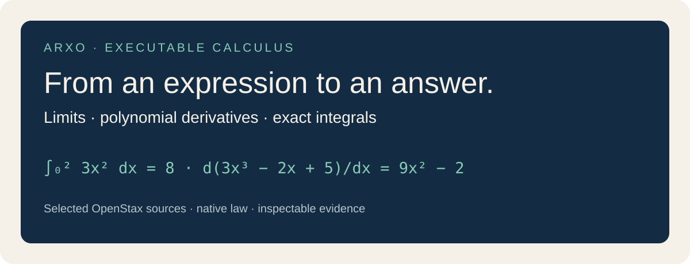
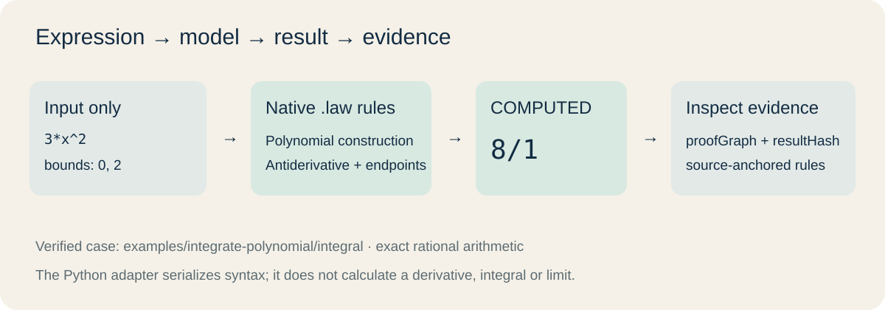
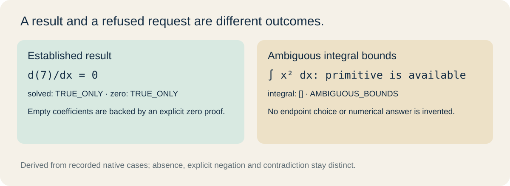
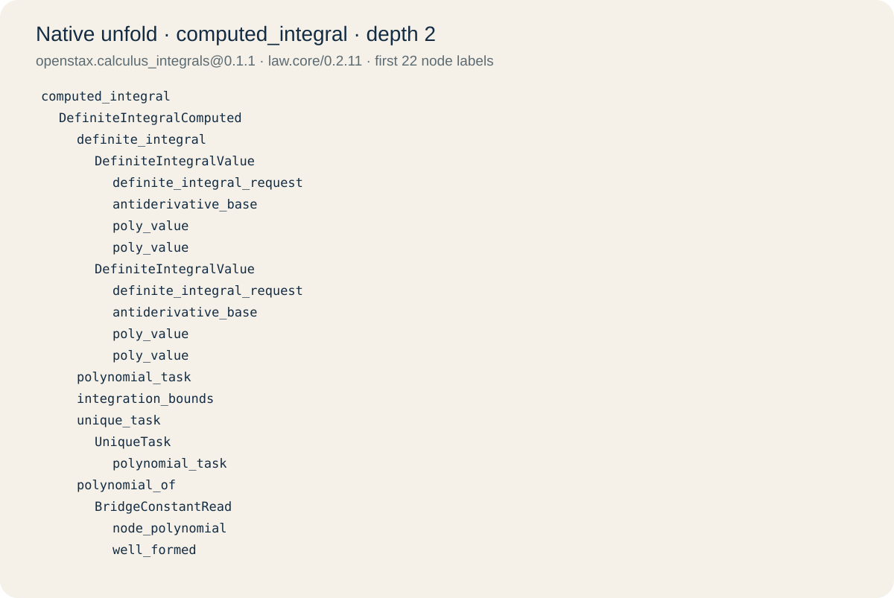

# OpenStax Calculus on Arxo

**Give the model an expression. Get an exact answer and the rules that produced it.**

This kit computes bounded automatic limits and differentiates, antidifferentiates
and integrates univariate polynomials over the rationals. It includes three
OpenStax models, their four computational dependencies and pinned source modules.
The models and algorithms execute in the published **`law`** CLI.

[Run a problem](#run-a-problem) · [Try your expression](#try-your-expression) ·
[Models](#models) · [Depth](#formalization-depth) · [Boundaries](#boundaries) ·
[Reproduce](#reproduce-the-delivery)

## Run a problem

Requires **Node.js 20+**. Model packages are delivered by GitHub, and the runtime
is installed through npm.

```sh
npm install -g @arxo/cli@0.2.5
git clone https://github.com/arxohq/arxo-openstax-calculus.git
cd arxo-openstax-calculus

# lim (x² − 1)/(x − 1), as x → 1
law eval examples/limit-cancel/result

# d(3x³ − 2x + 5)/dx
law eval examples/differentiate-polynomial/coefficients

# Integral of 3x² from 0 to 2
law eval examples/integrate-polynomial/integral
```

| Input | Native answer |
|---|---|
| `(x²−1)/(x−1)`, at `1` | `FINITE`, `rational`, `2/1` |
| derivative of `3x³−2x+5` | coefficients `0: −2/1`, `1: 0/1`, `2: 9/1` → `9x²−2` |
| primitive of `3x²`, explicitly choosing `C=5` | `x³+5` |
| integral of `3x²`, bounds `0, 2` | `8/1` |
| same integral, bounds `2, 0` | `−8/1` |

The complete [native input](examples/integrate-polynomial/integral/input.lawcase)
contains the expression nodes, operation, variable, bounds and explicit resource
contract. It supplies **no answer coefficients, integration value or method**.
The [request](examples/integrate-polynomial/integral/request.json) contains the
pinned linked world and query; the [recorded result](examples/integrate-polynomial/integral/result.json)
contains the canonical result hash and proof graph. [All cases and questions](examples/index.json).



## Try your expression

The optional **Python 3.12+** input adapter parses syntax and emits a native
`.lawcase`; every mathematical calculation still runs in `law`. It does not
pick a method, perform symbolic simplification or use an external CAS.

```sh
python3 tools/solve.py limit '(exp(x)-1)/x' --point 0
python3 tools/solve.py differentiate '3/2*x^2-1/3*x'
python3 tools/solve.py antidifferentiate '3*x^2' --constant 5
python3 tools/solve.py integrate '3*x^2' --lower 0 --upper 2
```

Use `--out runs/my-problem` to retain the `.lawcase`, request and result for each
question; `--json` prints complete canonical documents. Use a new output directory
for each capture. Example: `--variable t`, `--side right`, or `--approach plus_inf`.

Syntax: integers, decimal or literal rational numbers (`3/2`), variables, explicit
`*`, `+`, `-`, `/`, parentheses, nonnegative integer powers and the named functions
`sin`, `cos`, `exp`, `ln`, `sqrt`. Parsing a function does not promise that a
particular operation supports it. `-x^2` means `-(x^2)`. **Polynomial operations
accept sums, products and negation; powers must have the selected variable as
base.** Write `(x+1)*(x+1)` instead of `(x+1)^2` in this first expression bridge.
Antidifferentiation requires an explicit `--constant`; integration requires both bounds.

## Models

| Exact spec | Role | Source |
|---|---|---|
| `openstax.calculus_limits@0.1.1` | automatic limit task, outcome and L’Hôpital steps; existing limit checker | [limits](packages/openstax.calculus_limits/solver.law) |
| `openstax.calculus_derivatives@0.1.1` | automatic polynomial derivative; existing derivative checker | [derivatives](packages/openstax.calculus_derivatives/solver.law) |
| `openstax.calculus_integrals@0.1.1` | polynomial primitive and definite integral; existing integral checker | [integrals](packages/openstax.calculus_integrals/solver.law) |
| `calc.expressions@0.1.0` | finite expression syntax, well-formedness and structural relations | [expressions](packages/calc.expressions) |
| `calc.polynomials_q@0.1.0` | exact rational coefficients, construction, calculus and resource checks | [polynomials](packages/calc.polynomials_q) |
| `calc.calculus_checker@0.1.0` | validates supplied derivation steps | [checker](packages/calc.calculus_checker) |
| `calc.limit_solver@0.1.0` | bounded method generation and exact limit evaluation | [limit solver](packages/calc.limit_solver) |

The three reader models were extended from `0.1.0` to `0.1.1`. Original IR bytes
remain in `registry/original/`; the dependency versions are unchanged. Full
[identities and dependency closure](models.json), [source pin](source-pin.json).
These are independent reader worlds, not a general-purpose computer algebra system.

## Answers, uncertainty and evidence

```sh
law inspect examples/integrate-polynomial/integral/result.json summary
```

For polynomial operations, query `polynomial_solved`, `computed_coefficient`,
`computed_zero_polynomial` and `polynomial_problem` separately. Definite integration
adds `computed_integral`. Coefficients are canonical through the nonzero degree,
including internal zeros. An exact zero polynomial has an empty coefficient
collection **and an established `computed_zero_polynomial`**. An empty collection
on its own is not a mathematical zero.

A support query can return `TRUE_ONLY`, `FALSE_ONLY`, `BOTH` or `NEITHER`.
`NEITHER` means neither polarity is established, including the zero-support query
for a nonzero output; it is not Boolean false. Positive and negative facts remain
separate. Missing or conflicting inputs do not receive a default answer.



The retained boundary cases cover missing resource contracts, duplicate task
fields, missing or conflicting integration constants, ambiguous bounds and cap
exhaustion. A primitive can be available while a definite integral is refused:
see [ambiguous bounds](examples/ambiguous-integral-bounds).

For limits, inspect **`outcome` and `kind` first**. `PLUS_INFINITY`, `MINUS_INFINITY`
and `DOES_NOT_EXIST` are classifications, not finite rational answers. The raw
nonfinite record's `0/1` is a carrier sentinel; only `FINITE` with `rational`
uses the `value` field as a number. `1/x` at zero has a right-sided infinite limit
and a two-sided nonexisting limit.

Source links live on model fragments and source-anchored rules. A proof graph
and static unfold expose that structure. Direct query `sourceAnchors` arrays are
not promised to contain every reachable rule anchor, and a source citation does
not independently prove a theorem.

<details>
<summary>Open the native integral reasoning tree</summary>



[Exact native JSON](reports/unfold-integral.json), produced with:

```sh
law engine unfold registry/world/openstax.calculus_integrals.lawir.json computed_integral --clir registry/package --depth 2 --lang en --json
```

</details>

## Formalization depth

**Measured unit: one retained CNXML module, not an entire chapter or a percentage
of the book.** The denominator includes all 19 pinned modules. Measurement uses
the existing shared `boundaries.depth` classifier, counting only each package's
own nodes and preserving exact source editions. Imports do not inflate a model's depth.

| Package | Module denominator | `EXECUTABLE` | `SOURCE_ONLY` | No matching formalized anchor |
|---|---:|---:|---:|---:|
| limits | 6 | 6 | 0 | 0 |
| derivatives | 7 | 5 | 0 | 2 |
| integrals | 6 | 4 | 1 | 1 |

An executable module contains source-anchored executable interpretation; it does
not mean the module is completely formalized or that every exercise is solvable.
Legacy proof-checking rules and the new automatic bridges contribute to this
structural measure. Scope includes selected definition/rule modules; exercises,
other book modules and theorem-proof completeness are not measured.

The four computational dependencies are **`not_measured` on the publisher-module
axis**, because they have no declared publisher divisions. Their execution is
checked separately. [Per-unit report, hashes and omitted publications](reports/formalization-depth.json).

## Boundaries

- **Polynomials:** one variable over `Q`; exact rational coefficients and bounds.
  No general symbolic integration, multivariable calculus or arbitrary algebraic/
  transcendental coefficients. Compound power bases are currently unsupported by
  the expression-to-polynomial bridge.
- **Limits:** a bounded existing rule engine for supported rational cancellation,
  leading terms, elementary limits and eligible L’Hôpital chains. Unsupported
  forms and resource exhaustion remain explicit; this is not every limit problem.
- **Resources:** expression nodes and integer exponents are bounded by the pinned
  expression model (powers through 32). Polynomial descriptor carriers and degree
  caps are explicit inputs. The adapter supplies a finite 255-carrier inventory;
  `--cap` is not a promise of unlimited computation.
- **No altered golds:** historical mathematical expectations remain intact. New
  outcome-kind and diagnostic tests follow the native contracts. The new wrapper's
  dependency cycle was removed by separating construction from readiness queries.
- **Independent reference check:** all **35 declared limit-solver scenarios and
  97 published reader questions** have identical full canonical documents in native
  and reference execution, including statuses, proof graphs and hashes. The former
  memory refusal is closed with lossless transcript storage at the unchanged
  **64 MiB default**. This is addressed calculus comparison, not whole-corpus
  acceptance or completeness of the textbook.

## Sources and licensing

Sources: **OpenStax Calculus Volume 1**, Gilbert Strang and Edwin “Jed” Herman,
OpenStax / Rice University. The 19 original CNXML modules are pinned to
[`8dbc2ce`](https://github.com/openstax/osbooks-calculus-bundle/tree/8dbc2ce19e804924b2517b89ac72ee45be949d15),
with all publisher bytes rechecked independently against that immutable commit.
Edition labels, source hashes and anchors remain in the model data. Arxo’s
interpretations are independent adaptations; source pinning is distinct from
independent mathematical review.

**Publisher text and embedded quotations: CC BY-NC-SA 4.0.** Independent Arxo
algorithms, utilities and artwork: Apache-2.0. See [NOTICE](NOTICE),
[Apache license](LICENSE) and [publisher license](licenses/CC-BY-NC-SA-4.0.txt).
These terms also apply to quotations embedded in IR, requests and proof outputs.

## Reproduce the delivery

Download the [versioned GitHub Release](https://github.com/arxohq/arxo-openstax-calculus/releases/tag/v0.1.1)
for the exact archive, SHA-256 and inventory. There is no npm model package.

```sh
python3 tools/check.py --packages
python3 tools/measure_depth.py --check
```

The addressed verifier checks exact model/source/world identities, replays every task’s primary question and the critical zero/ambiguous-bound
questions twice, opens each reader world through native commands, checks
native source-anchored unfold and runs only the listed selected suites.
[Verification and limitations](reports/verification.json),
[package scenarios](reports/targeted-package-checks.json),
[repair record](reports/repairs.json), [reference comparison](reports/addressed-differential.json).
Use `--all-questions` for an optional replay of every recorded query. All 97 queries
were executed against the final world before freezing this delivery.
The verification report records the payload freeze; Release notes record public CI
and anonymous download checks.
Full corpus and general release acceptance were **not run**:
`releaseVerified: false`, corpus `not_checked`.
